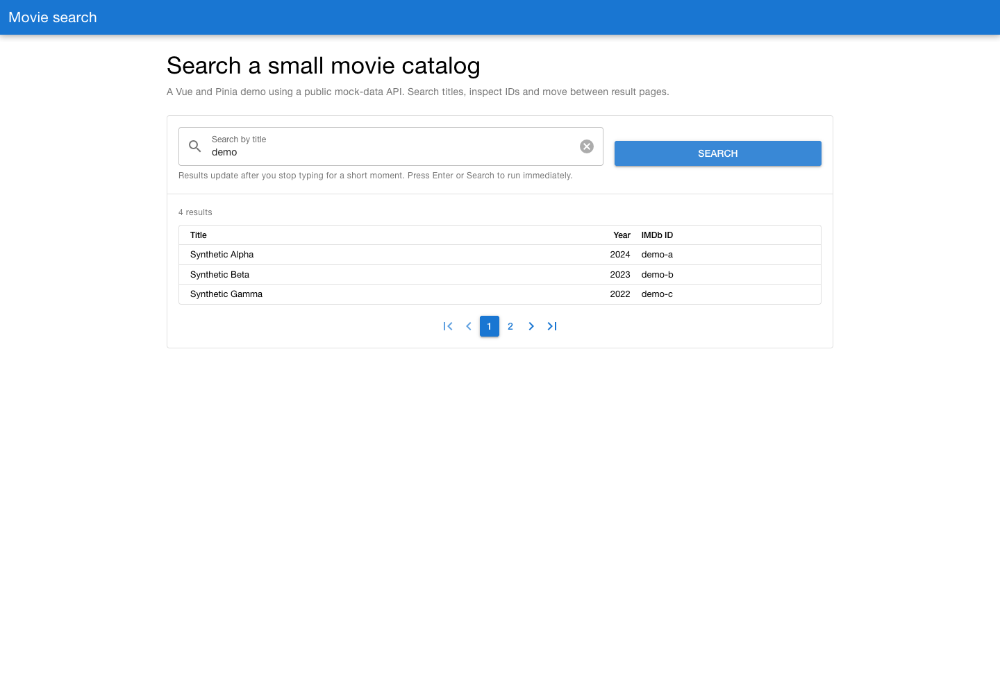
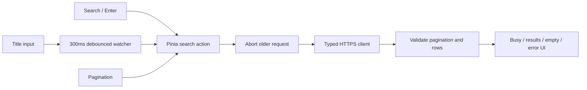

# Vue movie browser

A compact Vue 3/Pinia/Quasar app for searching titles in a public mock movie catalog. It demonstrates paginated API state, debounce/cancellation and visible loading, empty and error states. The original `JibbleGroup` package name is retained; this is not a streaming service or a movie-recommendation model.



[390px mobile preview](docs/screenshots/mobile.png). Screenshot titles/IDs are synthetic fixtures, not measured live search results.

## Run

Use Node 22.22+ and the npm lockfile:

```sh
npm ci --ignore-scripts
npm run dev
```

Vite serves the app at `http://localhost:5173`. No account, environment variable or API key is required. The client calls the fixed HTTPS origin `jsonmock.hackerrank.com`, using `/api/movies/search?Title=<encoded title>&page=<page>`.

```sh
npm run type-check
npm run build
npm run preview
```

The production output is in `dist/`. The duplicate Yarn lockfile was removed, and generated dependencies/build/test reports are now ignored.

## Search state and races



The input stays editable while a request runs. Clearing it resets the store; a null value from Quasar's actual Clear control is treated as empty, not the query `"null"`. The store ignores both successes and failures from obsolete requests. A failed current page clears stale totals/pagination alongside rows.

The client checks response structure and safe-integer pagination fields before rendering. Movie records contain title, numeric year and IMDb ID. The table uses the server's pages, not local pagination over a full downloaded catalog.

## Verification

```sh
npm run test:unit -- --run
# Use an existing system Chrome without downloading browsers:
CI=true PLAYWRIGHT_USE_SYSTEM_CHROME=1 npm run test:e2e -- --project=chromium
```

Nineteen unit tests pass for client/store/app behavior, including stale-failure races, reset races and malformed pagination. Three Chrome e2e tests pass for search/pagination, busy state and the actual Clear control. Type checking, production build and a separate read-only ESLint run pass. Additional Chrome checks covered desktop/390px layouts with synthetic responses; the screenshots above come from that run.

Browser/API tests intercept the mock API; no live provider request was needed. Firefox/WebKit projects remain configured but were not run. Installation emitted a Vite/devtools peer warning, and the legacy lockfile was otherwise preserved rather than expanding this into a dependency migration.

## Proportionate next steps

The app has no persistence, authentication, posters, detail pages or recommendation system. It depends on a public mock dataset whose availability is outside the project. Requests can be cancelled by a newer search but have no automatic deadline; add a timeout and a focused timeout test before hosting. Query state in the URL and a deliberate retry/cache policy would be more useful additions than a database or distributed infrastructure for this small client.
